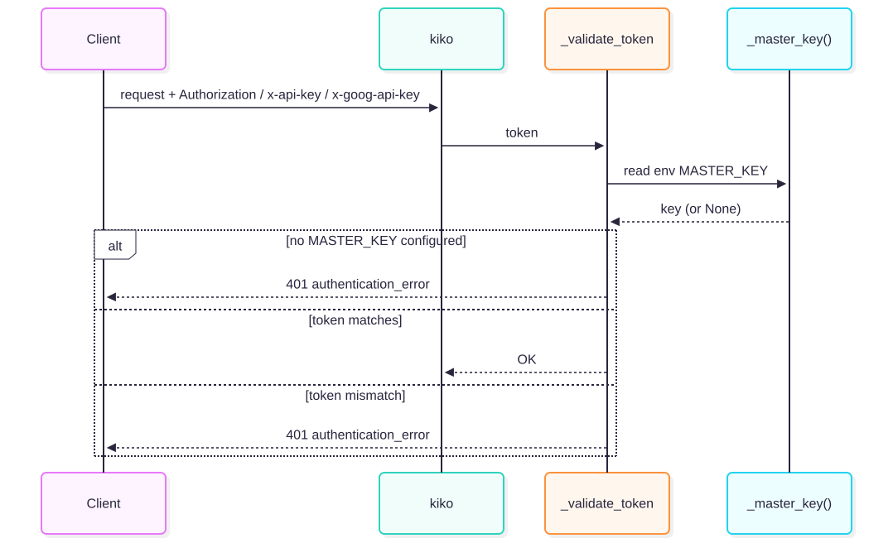
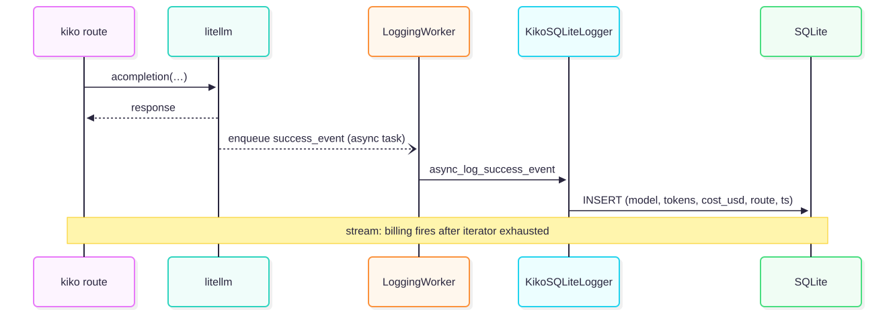

# kiko — Developer Documentation

## Overview

kiko is a security-hardened LiteLLM proxy that routes Claude Code, Gemini CLI, and Codex
through a single master key, recording per-call cost in a local SQLite database. It strips
dangerous client-supplied fields, enforces a server-side model allowlist, and shapes error
responses to match each client's expected format.

---

## Architecture



| Component | Role |
|---|---|
| **Claude Code** | Sets `ANTHROPIC_BASE_URL=http://localhost:4000`; sends `/v1/messages` |
| **Gemini CLI** | Sets `GEMINI_API_KEY=<master-key>`; sends `/v1beta/models/…:generateContent` |
| **Codex CLI** | Points `~/.codex/config.toml` at kiko; sends `/v1/responses` (planned) |
| **kiko-proxy** | FastAPI app on `:4000`; single entry point for all AI clients |
| **LiteLLM** | Handles protocol translation and upstream HTTPS calls |
| **kiko-tray** | GTK3 (Linux) or pystray (Windows) system tray that spawns kiko as a subprocess |
| **SQLite** | `~/.kircho/kircho.db` — stores billing rows; also the model registry |

The proxy binds to `127.0.0.1:4000` by default — localhost only, no network exposure.

---

## Authentication



Authentication is handled by `litellm/proxy/auth/user_api_key_auth.py`.

`_validate_token` is called for every request. It reads `MASTER_KEY` from the environment
on each call — the value is not frozen at import time, so `run_server()` can inject a
credential-store secret into `os.environ` after the module has loaded.

Three header forms are accepted (in priority order):

| Header | Format | Used by |
|---|---|---|
| `Authorization` | `Bearer <key>` | Claude Code, most OpenAI clients |
| `x-api-key` | `<key>` | Anthropic SDK |
| `x-goog-api-key` | `<key>` | Gemini CLI |

If `MASTER_KEY` is not set, every request returns `401 authentication_error`.
A missing or wrong token also returns `401 authentication_error`.

On Windows, `run_server()` can read the key from Windows Credential Manager at
`KIRCHO/MASTER_KEY` and inject it into `os.environ` before any request arrives.

---

## Security: `_prepare()` chokepoint


Every upstream request passes through `_prepare(model, body)` in `kiko_server.py`.
The function performs three steps in order:

1. **Alias resolution** — `_resolve_model_alias()` is called first. It checks YAML
   `model_aliases` glob patterns, then falls back to `ANTHROPIC_DEFAULT_*_MODEL` env vars.
   This happens before `_prepare` so the resolved name is used in the model-list lookup.

2. **Strip dangerous fields** — The following fields are removed from the client body
   unconditionally, regardless of model or route:
   `api_key`, `api_base`, `base_url`, `extra_headers`, `mock_response`,
   `custom_llm_provider`, `model_info`.
   This prevents a client from redirecting requests to attacker-controlled infrastructure
   or injecting fake credentials.

3. **Model allowlist** — Always enforced, unconditionally:
   - `404 No models configured` when the DB has no models at all.
   - `503 No models available` when models exist in the DB but all are disabled.
   - `404 Model not found` when the requested alias is not in the enabled model list.
   Unknown or disabled model names are rejected before any upstream connection is attempted.

4. **Server params win** — The configured `litellm_params` for the model (including
   `api_base` and `api_key`) are merged over the cleaned body. The server's routing
   always wins over anything the client might have supplied.

---

## Routes



All routes except `/health` require the master key (FastAPI `Depends(user_api_key_auth)`).

### OpenAI-compatible

| Endpoint | Body format | Response format |
|---|---|---|
| `POST /v1/chat/completions` | OpenAI chat | OpenAI chat completion |
| `POST /v1/completions` | OpenAI text | OpenAI text completion |
| `POST /v1/embeddings` | OpenAI embedding | OpenAI embedding response |

### Anthropic Messages API

| Endpoint | Body format | Response format |
|---|---|---|
| `POST /v1/messages` | Anthropic Messages | Anthropic Messages response |
| `POST /v1/messages` (stream) | Anthropic Messages + `stream: true` | Anthropic SSE stream |
| `POST /v1/messages/count_tokens` | Anthropic Messages | `{"input_tokens": N}` |

The Anthropic route uses `litellm.anthropic_messages()` with
`use_chat_completions_url_for_anthropic_messages=True` — this routes non-Anthropic
backends (e.g. NVIDIA NIM) through chat/completions rather than the Responses API.

### Gemini

| Endpoint | Body format | Response format |
|---|---|---|
| `POST /v1beta/models/:m:generateContent` | Gemini `contents` | Gemini `candidates` |
| `POST /models/:m:generateContent` | Gemini `contents` | Gemini `candidates` |
| `POST /v1beta/models/:m:streamGenerateContent` | Gemini `contents` | Gemini SSE (no `[DONE]`) |
| `POST /v1beta/models/:m:countTokens` | Gemini `contents` | `{"totalTokens": N}` |

The Gemini routes use `GOOGLE_GENAI_ADAPTER` from `litellm.google_genai.adapters.handler`
to translate between Gemini and OpenAI formats. The adapter is always used — the native
Gemini HTTP path is bypassed.

### Admin

| Endpoint | Auth | Response |
|---|---|---|
| `GET /health` | None | `{"status": "healthy"}` |
| `GET /health/liveliness` | None | `{"status": "healthy"}` |
| `GET /v1/models` | Required | OpenAI model list |

### Planned: Codex

`POST /v1/responses` (Responses API) is not yet implemented. The architecture diagram
shows it as a planned client path.

---

## Billing



Billing is implemented as a LiteLLM `CustomLogger` in
`litellm/proxy/integrations/kiko_sqlite_logger.py`.

### Two-hop async path

1. The route handler calls `litellm.acompletion()` (or `anthropic_messages`).
2. LiteLLM enqueues a success event in its internal `LoggingWorker` async task queue.
3. The worker calls `KikoSQLiteLogger.async_log_success_event`.
4. The logger inserts one row into the `billing` table, protected by `threading.Lock`
   (the DB is opened in WAL mode for concurrent readers).

For streaming calls, the billing event fires after the response iterator is fully
exhausted — not at stream start. This ensures token counts and cost are final.

### SQLite schema

Database path: `~/.kircho/kircho.db` (override with `KIKO_DB_PATH` env var).

```sql
CREATE TABLE billing (
    id         INTEGER PRIMARY KEY AUTOINCREMENT,
    model      TEXT    NOT NULL,
    tokens_in  INTEGER NOT NULL DEFAULT 0,
    tokens_out INTEGER NOT NULL DEFAULT 0,
    cost_usd   REAL    NOT NULL DEFAULT 0.0,
    ts         TEXT    NOT NULL   -- ISO-8601 UTC
);
```

Billing can be disabled with `general_settings.disable_billing: true` in the config.
A custom DB path can be set with `general_settings.billing_db: /path/to/db`.

Use `kiko --costs --days 30` for a per-model cost summary.

---

## Monthly Cap


A per-calendar-month spending cap keyed on `general_settings.monthly_cap_usd` is a
planned feature. When implemented, the check will run before `_prepare()`:

1. Query `SELECT SUM(cost_usd) FROM billing WHERE ts >= first_of_month`.
2. If the sum meets or exceeds `monthly_cap_usd`, refuse the request in the
   client's expected error format:
   - OpenAI: HTTP 429, `error.code = "capacity"`
   - Anthropic: HTTP 529, `error.type = "overloaded_error"`
   - Gemini: HTTP 429, `status = "RESOURCE_EXHAUSTED"`
   - Codex: HTTP 429, `error`

This feature is not yet in the codebase; the billing table already provides all
data needed to implement it.

---

## Running tests

```bash
python -m pytest tests/kiko -q
```

All unit and mock-backend tests are offline — `respx` intercepts upstream HTTP at the
`httpx` level. No real API keys are needed. The integration tests in `tests/kiko/`
that use `kiko_proxy` fixture are skipped automatically when no `GEMINI_API_KEY`
is found in the credential store.

---

## Adding a model

1. Add an entry to your config YAML (copy from `kiko-sample.yaml`):

```yaml
model_list:
  - model_name: my-model          # short alias used in API calls
    litellm_params:
      model: gemini/gemini-2.0-flash-lite
      api_key: os.environ/GEMINI_API_KEY
      # api_base: https://... (optional, for NIM or custom endpoints)
```

2. Seed the model into the DB and restart:

```bash
kiko --config kiko.yaml --init-db
kiko --config kiko.yaml
```

3. Or add at runtime without restarting:

```bash
kiko --add-model my-model --provider gemini/gemini-2.0-flash-lite --api-key-env GEMINI_API_KEY
```

### Test pattern (mock backend)

```python
async def test_my_model(mock_backend):
    async with httpx.AsyncClient(
        transport=httpx.ASGITransport(app=mock_backend["app"]),
        base_url="http://test",
    ) as client:
        r = await client.post(
            "/v1/chat/completions",
            headers={"Authorization": f"Bearer {mock_backend['key']}"},
            json={"model": "mock-model", "messages": [{"role": "user", "content": "hi"}]},
        )
    assert r.status_code == 200
    assert r.json()["choices"][0]["message"]["content"] == "Hello from mock!"
```

The `mock_backend` fixture (in `tests/kiko/conftest.py`) wires up an in-process
FastAPI app with `respx` intercepting calls to `http://mock-llm-api/v1/chat/completions`.
No real API keys or network access is required.
