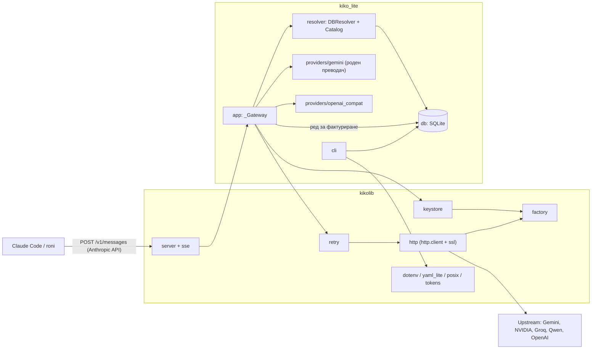
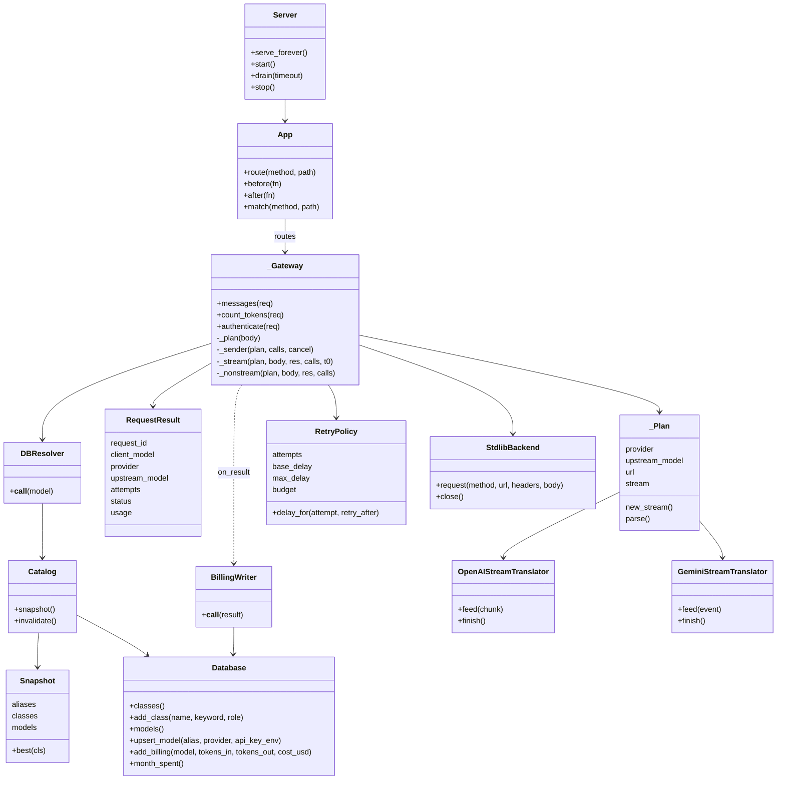
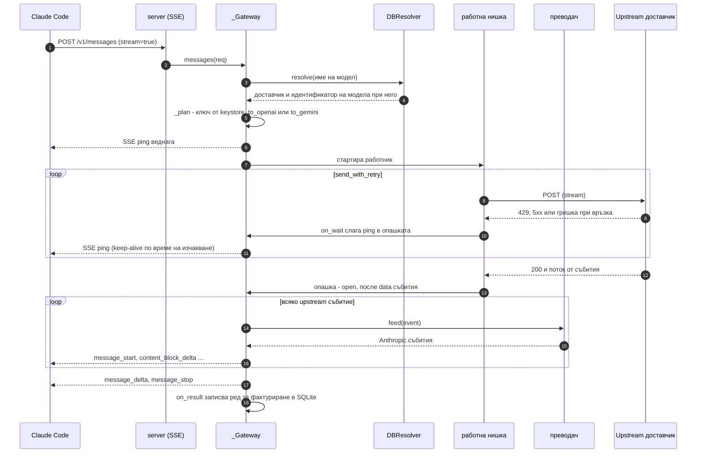
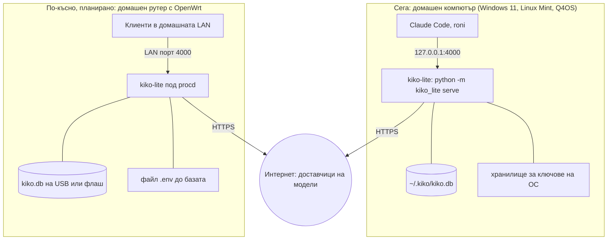

# Архитектура

kiko-lite има два Python пакета. **kikolib** е общ набор инструменти на стандартна библиотека, който не знае нищо за
модели. **kiko_lite** е приложението, построено върху него.

## Компоненти

| Пакет | Модул | Задача |
|---|---|---|
| kikolib | `http.py` | HTTP клиент върху `http.client` + `ssl`: keep-alive пул, поточни редове, proxy CONNECT, хранилище за доверие на ОС |
| kikolib | `server.py` + `sse.py` | многонишков HTTP сървър, router, streaming отговори, SSE кодиране/ping/парсер, `serve()` със сигнали и drain |
| kikolib | `retry.py` | политика за повторни опити: backoff + jitter, `Retry-After`, мек времеви бюджет, парчета `on_wait` (ползват се за SSE ping) |
| kikolib | `keystore.py` | API ключове: първо средата, после хранилищата на ОС (wcm, keychain, secret-tool, kwallet, dcop) |
| kikolib | `factory.py` | регистър, който избира имплементация по проба и приоритет (keystore, http) |
| kikolib | `posix.py` | сигнали, RSS, systemd notify/watchdog, частни файлове |
| kikolib | `yaml_lite.py` | YAML подмножество само за четене, само за еднократния внос на стар `kiko.yaml` |
| kikolib | `dotenv.py` | четец на `.env` |
| kikolib | `tokens.py` | резервна оценка на токени за `count_tokens` |
| kiko_lite | `app.py` | gateway: автентикация, план, изпращане с повторни опити, stream/non-stream, преобразуване на грешки, маршрути |
| kiko_lite | `resolver.py` | резолюция на клас/alias, снимка на каталога от базата, писач на фактуриране, портал за месечен лимит |
| kiko_lite | `providers/` | таблица с доставчици + `gemini.py` (роден преводач) + `openai_compat.py` (преводач на OpenAI chat) |
| kiko_lite | `db.py` | SQLite: models, model_classes, aliases, settings, billing; миграции |
| kiko_lite | `cli.py` | `python -m kiko_lite <command>` |

### Диаграма на компонентите

## Основни класове

Прочетени от реалния код (`kiko_lite/app.py`, `kiko_lite/resolver.py`, `kiko_lite/db.py`, `kikolib/`).

И двата преводача се казват `StreamTranslator` в собствения си модул (`providers/openai_compat.py` и
`providers/gemini.py`); диаграмата им дава различни имена само за да се различават. Таблицата с доставчици са
обикновени данни (`providers/__init__.py`, по един dict на доставчик), не класове.

## Една заявка със streaming

Ако `ping_interval` секунди (по подразбиране 10) не пристигне нищо, генераторът сам изпраща ping. Ако повторните опити
се изчерпат, клиентът получава `error` събитие в стила на Anthropic, а не увиснала връзка.

## Внедряване

Вариантът с рутер е план, вж. [ROADMAP](ROADMAP.md). На Linux без десктоп хранилище за ключове ключовете идват от
средата или от файл `.env` до файла на базата.
