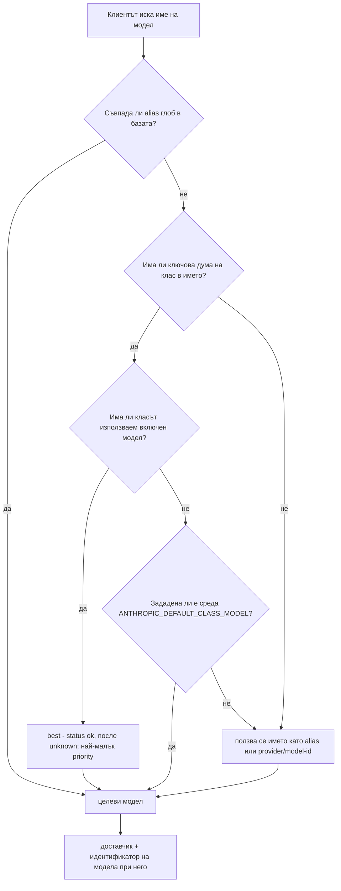
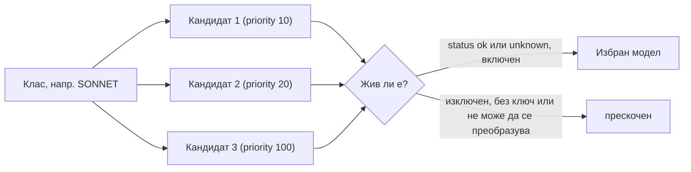

# Класове модели

## Идеята

Клиентът не назовава модел на конкретен доставчик. Той назовава **клас**, а kiko-lite избира модел от този клас.
Класът е описание на работа, не марка. Claude Code вече ползва три имена на класове (opus, sonnet, haiku) в
настройките си за модел, затова kiko-lite ги преизползва: агентната система roni на собственика казва само „тази
задача иска SONNET", а рутерът решава кой реален модел е той днес.

| Клас | Роля | Значение |
|---|---|---|
| HAIKU | работник | масова проста работа, евтина и бърза |
| SONNET | майстор | основната работа по изпълнението |
| OPUS | мениджър и оценител на работата | планира, преглежда, преценява резултата |
| FABLE | външен одитор | друг доставчик гледа работата; рядко и независимо |

Тези четири се зареждат предварително в базата (`DEFAULT_CLASSES` в `kiko_lite/db.py`).

## Сегашната карта на собственика

| Клас | Модел днес |
|---|---|
| OPUS | Gemini Flash или GPT-6 |
| SONNET | NVIDIA Nemotron Ultra (безплатно ниво) |
| HAIKU | Gemini flash-lite |
| FABLE | GPT-6 (рядко ползван) |

Това е конфигурация, не код: променете ред в таблицата `models` и следващата заявка я следва. Точните идентификатори
на моделите не са изброени тук, защото се менят; вижте `python -m kiko_lite list-models`.

## Как името в заявката става модел (ред на резолвъра)

`DBResolver.__call__` в `kiko_lite/resolver.py` пробва по ред:

1. **Alias глобове в базата** (таблица `aliases`, шаблон `fnmatch` към цел; печели първото съвпадение).
2. **Ключова дума на клас**: в поисканото име (с малки букви) се търси ключовата дума на всеки клас (например
   `claude-opus-4` съдържа `opus`). Ползва се най-добрият включен модел на този клас: първо статус `ok`, после
   `unknown`, после най-малък `priority`, после най-малък id (`Snapshot.best`).
3. **Среда**: `ANTHROPIC_DEFAULT_<CLASS>_MODEL` на съвпадналия клас, променливата, която самият Claude Code ползва, за да избира модел
   по клас. Стойността ѝ е alias или `provider/model-id`.
4. Самото име, като alias или директно `provider/model-id`.



## Класовете са данни

Класовете живеят в SQLite таблицата `model_classes` (версия на схемата 2): `name`, `keyword`, `role`, `sort`.

```
python -m kiko_lite list-classes
python -m kiko_lite add-class VOICE --keyword voice --role "speech output"
python -m kiko_lite add-model my-model --provider gemini/<model-id> --api-key-env GEMINI_API_KEY --class VOICE
```

Правила, наложени от `Database.add_class`: името е с главни букви (`^[A-Z][A-Z0-9_]{0,31}$`), ключовата дума е с малки
букви, от 3 до 64 знака, и никоя ключова дума не може да съдържа друга (откриването е първо съвпадение на подниз,
така че припокриващи се ключови думи биха скрили клас).

### Класове: планирани и кандидати

| Статус | Класове |
|---|---|
| Планирани | VOICE, EYES (вж. [Планирани класове](MODEL-CLASSES.md#planned-classes)) |
| Кандидати | вж. [Планирани класове](MODEL-CLASSES.md#planned-classes) |

Забележка: днес kiko-lite обслужва само текстовата крайна точка на Anthropic (`/v1/messages`,
`/v1/messages/count_tokens`). Класовете за други медии първо се нуждаят от други крайни точки и преводачи; таблицата
е готова, крайните точки не са.

<a id="planned-classes"></a>

## Планирани класове

Пълният списък с класове, които очакваме да добавим. Колоната „Вид" казва дали класът е езиков модел (LLM) и каква форма на API му трябва.

| Клас | Какво прави | Вид (форма на API) | Примерни модели или доставчици | Статус |
|---|---|---|---|---|
| VOICE | текст в реч | не-LLM (аудио навън) | OpenAI TTS, ElevenLabs, Gemini TTS | планиран |
| EYES | разбира изображения и екранни снимки | LLM (чат с изображение на входа) | Gemini, визуални модели на GPT, Claude vision | планиран |
| EARS | реч в текст | не-LLM (аудио на входа) | Whisper, Deepgram, Gemini audio | предложен (оркестратор) |
| MEMORY/EMBED | embeddings за търсене и памет | не-LLM (embeddings) | OpenAI embeddings, Gemini embeddings, Voyage, локални bge/e5 | предложен (оркестратор) |
| RERANK | пренарежда резултатите от търсене по релевантност | не-LLM (rerank) | Cohere Rerank, Voyage rerank, локален bge-reranker | предложен (одитор) |
| GUARD | модерация и филтър за безопасност | LLM или класификатор (чат или класификация) | OpenAI moderation, Llama Guard, филтри за безопасност на Gemini | предложен (одитор) |
| CODER | модел, специализиран в код | LLM (чат) | Qwen Coder, Codestral, codex моделите на GPT | предложен (одитор) |
| ROUTER/CLASSIFIER | малък бърз модел, който решава какъв клас или обработчик иска заявката | малък LLM или класификатор (чат или класификация) | малки локални модели, модели от клас flash-lite | предложен (одитор) |
| TUTOR/SCOUT | евтин четец на дълъг контекст, който смила големи документи | LLM (чат, дълъг контекст) | Gemini Flash и flash-lite, други модели с дълъг контекст | предложен (одитор) |
| OCR/DOC | текст и таблици от сканирани документи или PDF | не-LLM или визуален LLM (документ или изображение на входа) | Mistral OCR, Google Document AI, Tesseract | предложен (одитор) |
| PAINTER | генериране на изображения | не-LLM (изображение навън) | Imagen, моделите за изображения на GPT, Stable Diffusion, Flux | предложен (оркестратор) |
| VIDEO | генериране или разбиране на видео | не-LLM или мултимодален LLM (видео на входа или изхода) | Veo, Sora, видео вход на Gemini | предложен (оркестратор) |
| MUSIC | генериране на музика и аудио | не-LLM (аудио навън) | Lyria, Suno, MusicGen | предложен (оркестратор) |
| WATCH/DETECT | откриване на обекти във видеопотоци от камери, включително номера и лица; услуга в локалната мрежа, не облачен модел | не-LLM (откриване във видеопотоци) | YOLO, Frigate, локални разпознавачи на номера и лица | предложен (оркестратор) |
| SENSOR | модели върху данни от сензори или времеви редове, напр. откриване на аномалии | не-LLM (времеви редове) | детектори на аномалии, модели за прогнозиране | предложен (одитор) |
| REALTIME | гласови или чат сесии с ниско закъснение, поток в двете посоки | LLM (реално време, двупосочен streaming) | OpenAI Realtime, Gemini Live | предложен (оркестратор) |
| ACTION | модели, които работят с компютъра или действат чрез инструменти | LLM (чат с инструменти) | Claude computer use, computer-use моделите на OpenAI | предложен (одитор) |

Класът е просто ред в базата (`add-class`), така че текстовите класове не искат код. Класовете, които не са чат (аудио,
изображения, embeddings, откриване), първо се нуждаят от нов входен маршрут или нова форма на доставчика. Списъкът
дойде от одита на 2026-10-30: одиторът предложи класове, без да види нашия списък, и двата списъка бяха слети.

## От клас до избран жив модел



Честно състояние: проверката „жив" днес е само това, което е в реда (`enabled`, `status`), плюс дали редът може да се
преобразува към доставчик. Нищо в kiko-lite още не проверява доставчика и не сменя `status` автоматично; това е
watchdog-ът в [ROADMAP](ROADMAP.md).

## По-късно: счетоводителят (планирано)

Идея, не е построена: „счетоводител", който знае цените и лимитите на безплатните нива и предлага най-евтиния жив
модел за даден клас. Таблицата за фактуриране вече записва токени и цена на заявка, а `models` има колони за цени, така
че данните за него се събират.
