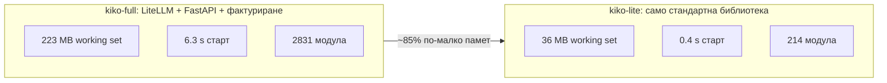

# Числа

kiko-lite срещу kiko-full на базата на LiteLLM, измерено на Windows, медиана от 3 пускания.

| Мярка | kiko-lite | kiko-full (LiteLLM) |
|---|---|---|
| Working set | 36.0 MB | 223.2 MB |
| Частна памет | 22.3 MB | 204.1 MB |
| Време за старт | 0.4 s | 6.3 s (студен старт 13.5 s) |
| Заредени модули | 214 | 2831 |

За сравнение, гол интерпретатор на Python има working set 25.5 MB, т.е. kiko-lite добавя около 10 MB отгоре.

## Какво е изрязано и защо

Първият план (бележка от 2026-10-28) изброяваше какво да се махне от LiteLLM. Резюме, с отбелязани по-късните промени.

| Част от LiteLLM | Какво прави | Защо е махната |
|---|---|---|
| 147 адаптера за доставчици (около 990 файла) | говорят с всеки доставчик | доставчиците на собственика говорят OpenAI-съвместимо или Gemini natively; запис в таблица заменя папка |
| Интеграции (Langfuse, OpenTelemetry, Datadog, S3, Slack) | логове и известия | логваме в собствения си SQLite |
| Proxy сървър (FastAPI, екипи, бюджети, Postgres, SSO, MCP) | администрация и много потребители | заменен от `kikolib/server.py`; ключовете и лимитите са в SQLite |
| Router, кеширане, scheduler | балансиране на натоварването, Redis кеш, опашка | един потребител; failover ще е наш собствен, вж. [ROADMAP](ROADMAP.md) |
| Други API (assistants, batches, files, images, rerank, ...) | крайни точки за функции | Claude Code ползва само `/v1/messages` и `count_tokens` |
| Допълнителни маршрути (`/v1/chat/completions`, `/v1/embeddings`, ...) | преведени маршрути | засега не са в kiko-lite |
| Административен интерфейс (около 2 270 файла) | табло | вместо него: `doctor`, `costs` и SQLite |
| Тестове на LiteLLM (около 4 000 файла) | тестове на горното | изчезват заедно с кода |
| Тежки пакети (httpx, aiohttp, openai, pydantic, fastapi, uvicorn, pyyaml, tiktoken, ...) | HTTP, сървър, конфигурация, токени | заменени от `http.client`, `ssl`, `http.server`, `sqlite3`, `json`; броят токени идва от `usage` на доставчика |

## Какво в старата бележка вече е остаряло

Бележката със списъка за рязане е писана преди няколко решения. Където се различава от кода, прав е кодът:

- Тя казва, че до Gemini се стига през OpenAI-съвместимия формат. Днес Gemini има **собствен роден преводач**
  (`kiko_lite/providers/gemini.py`), включително thought signatures.
- Тя говори за тайни, четени като в kiko-full. Днес ключовете отиват в **хранилищата за ключове на ОС**
  (`kikolib/keystore.py`), като първо се гледа средата; базата пази само имена на ключове.
- Тя говори за TOML конфигурация. Днес конфигурацията е **SQLite** (`models`, `model_classes`, `aliases`, `settings`);
  еднократен `import` чете стар `kiko.yaml` чрез `kikolib/yaml_lite.py`.
- Тя казва, че самият Anthropic не е доставчик: това още важи за таблицата с доставчици в `providers/__init__.py`
  (nvidia, groq, dashscope, openai, gemini).

Непроверено тук: измерванията са предоставени от тестовите пускания на собственика на проекта; не са пускани наново за тази страница.
