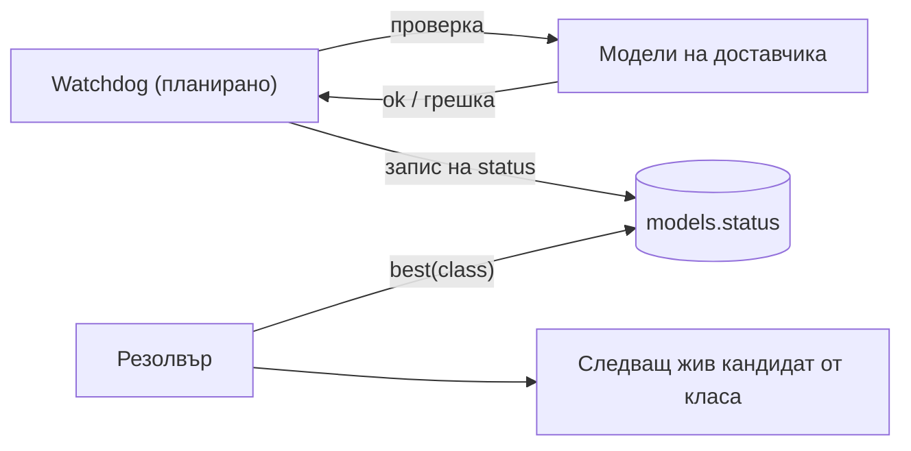
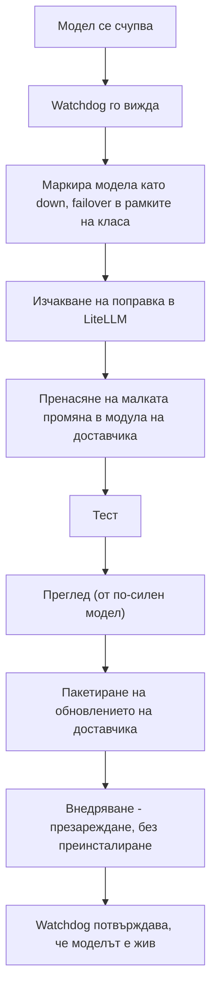

# Пътна карта

Всичко на тази страница е **планирано**, освен ако не е казано друго.

## Watchdog и превключване при отказ (failover) в рамките на клас (планирано, задача #90)

Днес kiko-lite избира най-добрия модел на клас от базата (`Snapshot.best`), но не проверява дали доставчикът е жив
и не превключва към следващия модел на класа, когато един се счупи. Слоят за повторни опити (`kikolib/retry.py`)
повтаря към същия доставчик само при грешки 429/5xx/грешки при връзка.

Честна история: по-старият kiko-full на базата на LiteLLM имаше фонов цикъл за проверка на здравето (`_health_loop`).
kiko-lite още няма такъв. Колоните `models.status` и `last_check` съществуват (копирани от kiko-full), но нищо в
kiko-lite не ги пише автоматично.

План: нишка-watchdog проверява (probe) всеки включен модел, записва `status` (`ok` / `down`), а резолверът вече
предпочита `ok` пред `unknown`. Failover тогава значи: ако най-добрият модел е `down`, ползва се следващият кандидат
от същия клас по `priority`.

## Обновяеми доставчици (планирано, задача #91)

Доставчиците трябва да могат да се обновяват без преинсталиране на програмата: един или 100 наведнъж, презаредени
без преинсталиране. Всеки модул за доставчик ще записва от кой commit на LiteLLM е пренесен, за да знаем кои
поправки от upstream имаме и кои нямаме. Днес таблицата с доставчици е Python dict в
`kiko_lite/providers/__init__.py`, а двата преводача са обикновени модули; механизъм за презареждане няма.

## Процедурата за поправка, задвижвана от събитие (планирано)

LiteLLM е колективният опит на света с особеностите на доставчиците. kiko-lite не го копира; пренася малки поправки,
когато някой модел се счупи.

## Цел: рутер (планирано)

Евтин домашен рутер може да пуска kiko-lite като постоянна услуга.

| Точка | Стойност |
|---|---|
| Система | OpenWrt |
| Python | python3 3.11, 3.13 или 3.14 (kiko-lite иска 3.11+) |
| Място | 128 MB или повече флаш, 256 MB или повече RAM, или USB флашка |
| Услуга | init скрипт за `procd` |
| Ключове | средата или `.env` до базата (на рутер няма десктоп хранилище за ключове) |

Непроверено: точният набор пакети на OpenWrt, паметта на kiko-lite върху архитектурата на рутера и дали всички модули
на стандартната библиотека, които kiko-lite импортира (`sqlite3`, `ssl`, `ctypes`), присъстват в пакетите на Python
за OpenWrt. Нужен е тест на реално устройство.

## Цели за Linux

Linux Mint 22.3 и Q4OS 6 (TDE). Хранилищата за ключове на Linux (secret-tool, KWallet, dcop за TDE) са в
`kikolib/keystore.py`; `dcop` е отбелязан като непроверен в `kikolib/README.md`, а `tools/linux_keystore_check.py` и
`docs/LINUX-KEYSTORE-TEST.md` съществуват за проверката им на реална машина.
