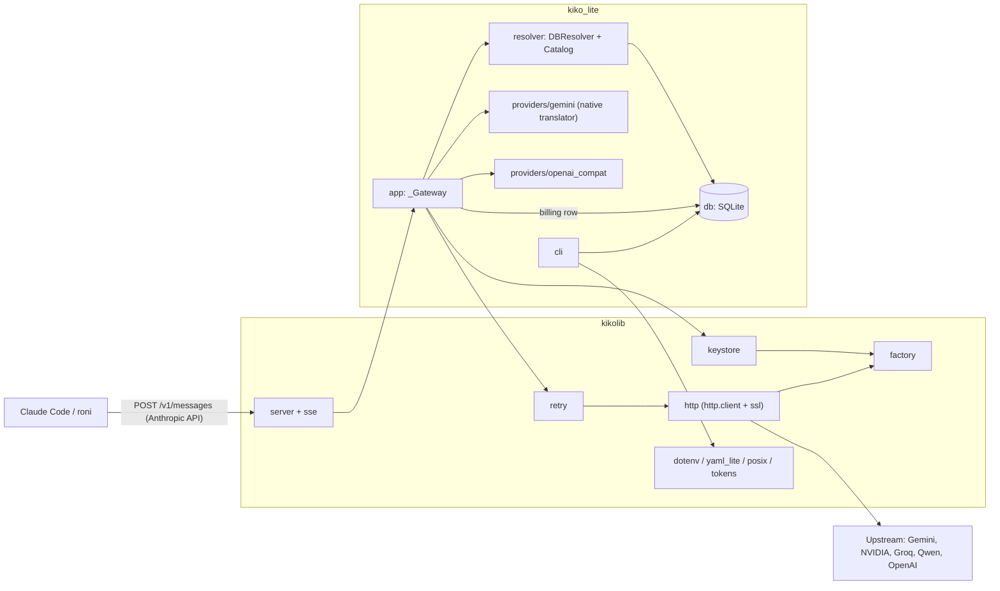
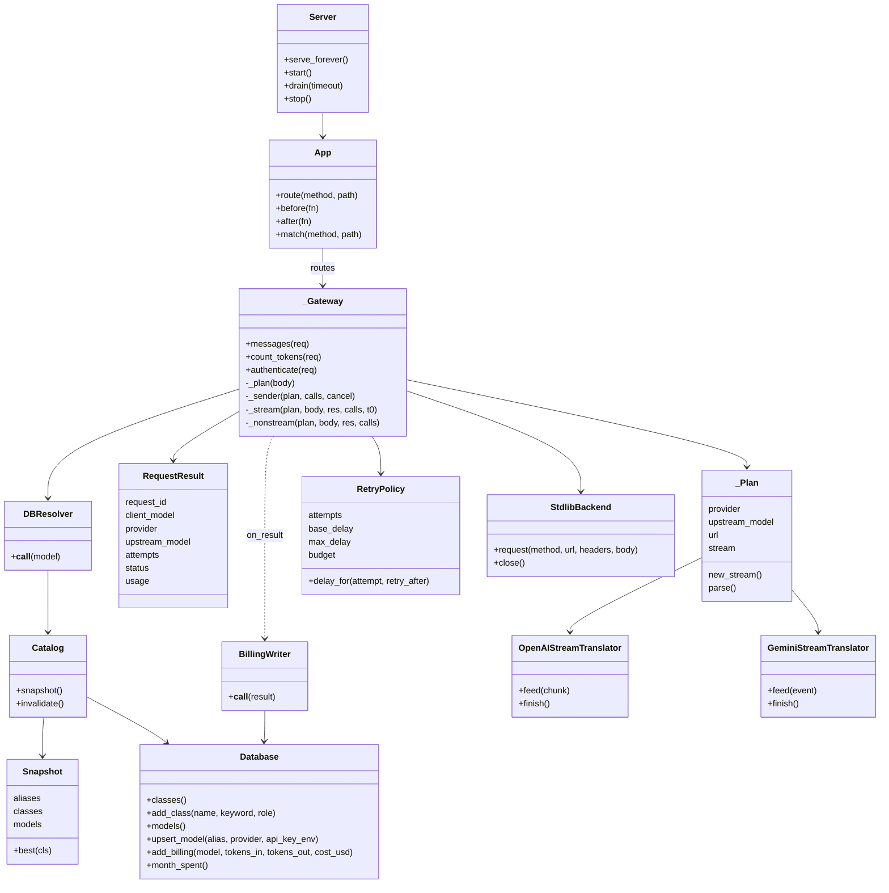
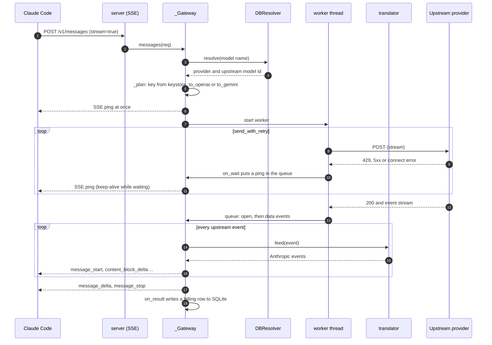
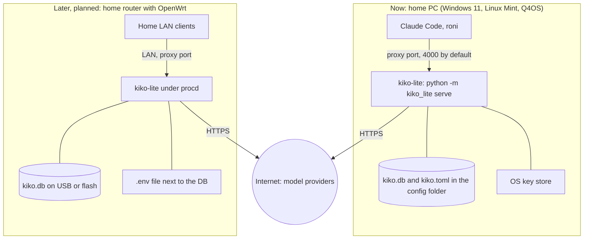

# Architecture

kiko-lite has two Python packages. **kikolib** is a generic standard-library toolkit that knows nothing about
models. **kiko_lite** is the application built on it.

## Components

| Package | Module | Job |
|---|---|---|
| kikolib | `http.py` | HTTP client on `http.client` + `ssl`: keep-alive pool, streamed lines, proxy CONNECT, OS trust store |
| kikolib | `server.py` + `sse.py` | threaded HTTP server, router, streaming responses, SSE encode/ping/parser, `serve()` with signals and drain |
| kikolib | `retry.py` | retry policy: backoff + jitter, `Retry-After`, soft time budget, `on_wait` slices (used for SSE pings) |
| kikolib | `keystore.py` | API keys: env first, then OS stores (wcm, keychain, secret-tool, kwallet, dcop) |
| kikolib | `factory.py` | registry that picks an implementation by probe and priority (keystore, http) |
| kikolib | `posix.py` | signals, RSS, systemd notify/watchdog, private files |
| kikolib | `yaml_lite.py` | read-only YAML subset, only for the one-time import of an old `kiko.yaml` |
| kikolib | `dotenv.py` | `.env` reader |
| kikolib | `tokens.py` | fallback token estimate for `count_tokens` |
| kiko_lite | `app.py` | gateway: auth, plan, send with retry, stream/non-stream, error mapping, routes |
| kiko_lite | `resolver.py` | class/alias resolution, DB catalog snapshot, billing writer, monthly cap gate |
| kiko_lite | `providers/` | provider table + `gemini.py` (native translator) + `openai_compat.py` (OpenAI chat translator) |
| kiko_lite | `db.py` | SQLite: models, model_classes, aliases, settings, billing; migrations |
| kiko_lite | `cli.py` | `python -m kiko_lite <command>` |

### Component diagram

## Main classes

Read from the real code (`kiko_lite/app.py`, `kiko_lite/resolver.py`, `kiko_lite/db.py`, `kikolib/`).

Both translators are called `StreamTranslator` in their own module (`providers/openai_compat.py` and
`providers/gemini.py`); the diagram gives them distinct names only to tell them apart. The provider table is plain
data (`providers/__init__.py`, one dict per provider), not classes.

## One streaming request

If nothing arrives for `ping_interval` seconds (default 10), the generator sends a ping by itself. If the retries
run out, the client gets an Anthropic-style `error` event, not a hung connection.

## Deployment

The router variant is a plan, see [ROADMAP](ROADMAP.md). On Linux without a desktop key store, keys come from env or
a `.env` file next to the DB file.
