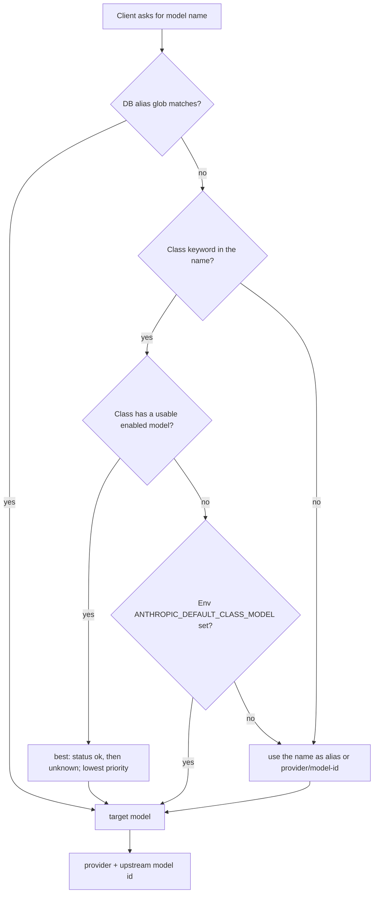
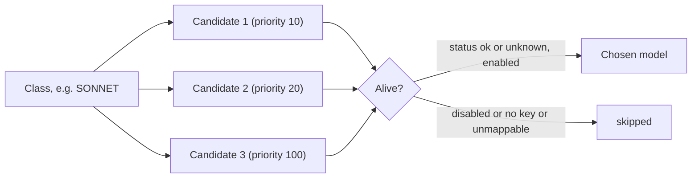

# Model classes

## The idea

A client does not name a vendor model. It names a **class**, and kiko-lite picks a model of that class. The class is a
job description, not a brand. Claude Code already uses three class names (opus, sonnet, haiku) in its model
settings, so kiko-lite reuses them: the owner's agent system roni only says "this task needs a SONNET", and the
router decides which real model that is today.

| Class | Role | Meaning |
|---|---|---|
| HAIKU | laborer | bulk simple work, cheap and fast |
| SONNET | craftsman | the main implementation work |
| OPUS | manager and evaluator of the work | plans, reviews, judges the result |
| FABLE | external auditor | a different vendor looks at the work; rare and independent |

These four and all the classes of [Planned classes](MODEL-CLASSES.md#planned-classes) are seeded into the database
(`DEFAULT_CLASSES` in `kiko_lite/db.py`; schema version 3 adds the planned ones once to an existing database, and a
class you delete later is not added again). Where the list has two names, the first is the class name (MEMORY,
ROUTER, TUTOR, OCR, WATCH). A few keywords carry a `kiko-` prefix (for example `kiko-coder`) so that ordinary model
names such as `deepseek-coder` do not change class.

## The owner's current map

| Class | Model today |
|---|---|
| OPUS | Gemini Flash, or GPT-6 |
| SONNET | NVIDIA Nemotron Ultra (free tier) |
| HAIKU | Gemini flash-lite |
| FABLE | GPT-6 (rarely used) |

This is a configuration, not code: change a row in the `models` table and the next request follows. Exact model ids
are not listed here because they change; look at `python -m kiko_lite list-models`.

## How a request name becomes a model (resolver order)

`DBResolver.__call__` in `kiko_lite/resolver.py` tries, in this order:

1. **DB alias globs** (`aliases` table, `fnmatch` pattern to target; first match wins).
2. **Class keyword**: the lower-cased requested name is searched for the keyword of each class (for example
   `claude-opus-4` contains `opus`). The best enabled model of that class is used: status `ok` first, then
   `unknown`, then lowest `priority`, then lowest id (`Snapshot.best`).
3. **Environment**: `ANTHROPIC_DEFAULT_<CLASS>_MODEL` of the matched class, the variable Claude Code itself uses to choose a model per
   class. Its value is an alias or `provider/model-id`.
4. The name itself, as an alias or a direct `provider/model-id`.



## Classes are data

Classes live in the SQLite table `model_classes` (schema version 4): `name`, `keyword`, `role`, `sort`.

```
python -m kiko_lite list-classes
python -m kiko_lite add-class VOICE --keyword voice --role "speech output"
python -m kiko_lite add-model my-model --provider gemini/<model-id> --api-key-env GEMINI_API_KEY --class VOICE
```

Rules enforced by `Database.add_class`: name is upper-case (`^[A-Z][A-Z0-9_]{0,31}$`), keyword is lower-case,
3 to 64 characters, and no keyword may contain another (detection is a first substring match, so overlapping
keywords would hide a class).

## Providers are data too

The providers a model can use live in the table `providers` (schema version 4): `name`, `api_base`,
`api_key_env` (the key NAME, never the key), `sort`. It is seeded once with the providers kiko-lite supports:

| name | api_base | key name |
|---|---|---|
| gemini | https://generativelanguage.googleapis.com | GEMINI_API_KEY |
| nvidia | https://integrate.api.nvidia.com/v1 | NVIDIA_API_KEY |
| openai | https://api.openai.com/v1 | OPENAI_API_KEY |
| groq | https://api.groq.com/openai/v1 | GROQ_API_KEY |
| dashscope | https://dashscope-intl.aliyuncs.com/compatible-mode/v1 | DASHSCOPE_API_KEY |
| mistral | https://api.mistral.ai/v1 | MISTRAL_API_KEY |

```
python -m kiko_lite list-providers
python -m kiko_lite add-provider acme --api-base https://api.acme.example/v1 --api-key-env ACME_API_KEY
python -m kiko_lite delete-provider acme     # refused while a model uses it
```

A model row still stores `<provider>/<model id>` (for NVIDIA: `nvidia/nvidia/nemotron-3-ultra-550b-a55b`), its
`api_base` and its `api_key_env`, so the resolver and the proxy are unchanged. The web form (Models, Add model)
picks the provider and the class from list boxes, takes the model id as text and fills the API base and key name
from the provider; an optional override is in the "Override" section. Status is not edited by hand (the health
prober sets it). kiko-lite itself fixes the API base of the six providers above (the base in the table is shown read-only, "fixed by
kiko for this provider"); only the key name of those can be changed, and an API base override on a model is
accepted only for openai and for providers you add yourself. A provider you add (not one of the six) is served as a
custom OpenAI-compatible endpoint: the form stores the provider's API base on the model row, and the bare model id
(`m1` for `acme/m1`) is what is sent upstream. Every stored API base must be a plain https URL (http only to
localhost) without credentials, query or fragment, and a key name must be a name, never a key value. A model row
whose prefix is not in the providers table (for example one imported from kiko-full) keeps the old rule: the
whole text is the model id.

### Classes: planned and candidates

| Status | Classes |
|---|---|
| Planned | VOICE, EYES (see [Planned classes](MODEL-CLASSES.md#planned-classes)) |
| Candidates | see [Planned classes](MODEL-CLASSES.md#planned-classes) |

Note: today kiko-lite serves only the Anthropic text endpoint (`/v1/messages`, `/v1/messages/count_tokens`). Classes
for other media need other endpoints and translators first; the table is ready, the endpoints are not.

<a id="planned-classes"></a>

## Planned classes

The full list of classes we expect to add. Kind says whether the class is a language model (LLM) and which API shape it needs.

| Class | What it does | Kind (API shape) | Example models or vendors | Status |
|---|---|---|---|---|
| VOICE | text-to-speech | non-LLM (audio out) | OpenAI TTS, ElevenLabs, Gemini TTS | planned |
| EYES | understands images and screenshots | LLM (chat with image input) | Gemini, GPT vision models, Claude vision | planned |
| EARS | speech-to-text | non-LLM (audio in) | Whisper, Deepgram, Gemini audio | proposed (orchestrator) |
| MEMORY/EMBED | embeddings for search and memory | non-LLM (embeddings) | OpenAI embeddings, Gemini embeddings, Voyage, local bge/e5 | proposed (orchestrator) |
| RERANK | reorders search results by relevance | non-LLM (rerank) | Cohere Rerank, Voyage rerank, local bge-reranker | proposed (auditor) |
| GUARD | moderation and safety filter | LLM or classifier (chat or classify) | OpenAI moderation, Llama Guard, Gemini safety filters | proposed (auditor) |
| CODER | code-specialized model | LLM (chat) | Qwen Coder, Codestral, GPT codex models | proposed (auditor) |
| ROUTER/CLASSIFIER | tiny fast model that decides which class or handler a request needs | small LLM or classifier (chat or classify) | small local models, flash-lite class models | proposed (auditor) |
| TUTOR/SCOUT | cheap long-context reader that digests big documents | LLM (chat, long context) | Gemini Flash and flash-lite, other long-context models | proposed (auditor) |
| OCR/DOC | text and tables from scans or PDFs | non-LLM or vision LLM (document or image in) | Mistral OCR, Google Document AI, Tesseract | proposed (auditor) |
| PAINTER | image generation | non-LLM (image out) | Imagen, GPT image models, Stable Diffusion, Flux | proposed (orchestrator) |
| VIDEO | video generation or understanding | non-LLM or multimodal LLM (video in or out) | Veo, Sora, Gemini video input | proposed (orchestrator) |
| MUSIC | music and audio generation | non-LLM (audio out) | Lyria, Suno, MusicGen | proposed (orchestrator) |
| WATCH/DETECT | object detection on camera streams, including plates and faces; a LAN service, not a cloud model | non-LLM (detection on streams) | YOLO, Frigate, local plate and face recognizers | proposed (orchestrator) |
| SENSOR | models over sensor or time-series data, e.g. anomaly detection | non-LLM (time series) | anomaly detectors, forecasting models | proposed (auditor) |
| REALTIME | low-latency voice or chat sessions, streaming both ways | LLM (realtime, bidirectional streaming) | OpenAI Realtime, Gemini Live | proposed (orchestrator) |
| ACTION | computer-use or tool-acting models | LLM (chat with tools) | Claude computer use, OpenAI computer-use models | proposed (auditor) |

A class is just a database row (`add-class`), so text classes need no code. Non-chat classes (audio, image, embeddings,
detection) need a new ingress route or provider shape before they work. This list came from the 2026-10-30 audit: the
auditor proposed classes without seeing our list, and the two lists were merged.

## From class to a chosen alive model



Honest status: the "alive" check today is only what is in the row (`enabled`, `status`) plus whether the row can be
mapped to a provider. Nothing in kiko-lite probes the provider or flips `status` automatically yet; that is the
watchdog in the [ROADMAP](ROADMAP.md).

## Later: the bookkeeper (planned)

An idea, not built: a "bookkeeper" that knows prices and free-tier limits and suggests the cheapest alive model for a
class. The billing table already records tokens and cost per request, and `models` has price columns, so the data
for it is being collected.
