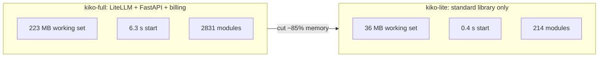

# Numbers

kiko-lite against the LiteLLM-based kiko-full, measured on Windows, median of 3 runs.

| Measure | kiko-lite | kiko-full (LiteLLM) |
|---|---|---|
| Working set | 36.0 MB | 223.2 MB |
| Private memory | 22.3 MB | 204.1 MB |
| Start time | 0.4 s | 6.3 s (cold start 13.5 s) |
| Loaded modules | 214 | 2831 |

For comparison, a bare Python interpreter has a working set of 25.5 MB, so kiko-lite adds about 10 MB on top of it.

## What was cut and why

The first plan (note of 2026-10-28) listed what to drop from LiteLLM. Summary, with the later changes marked.

| Part of LiteLLM | What it does | Why dropped |
|---|---|---|
| 147 provider adapters (about 990 files) | talk to every vendor | the owner's providers speak OpenAI-compatible, or Gemini natively; a table entry replaces a folder |
| Integrations (Langfuse, OpenTelemetry, Datadog, S3, Slack) | logging and alerts | we log to our own SQLite |
| Proxy server (FastAPI, teams, budgets, Postgres, SSO, MCP) | admin and multi-user | replaced by `kikolib/server.py`; keys and caps are in SQLite |
| Router, caching, scheduler | load balancing, Redis cache, queue | one user; failover will be our own, see [ROADMAP](ROADMAP.md) |
| Other APIs (assistants, batches, files, images, rerank, ...) | feature endpoints | Claude Code uses only `/v1/messages` and `count_tokens` |
| Extra routes (`/v1/chat/completions`, `/v1/embeddings`, ...) | translated routes | not in kiko-lite for now |
| Admin UI (about 2,270 files) | dashboard | `doctor`, `costs` and SQLite instead |
| LiteLLM tests (about 4,000 files) | tests of the above | gone with the code |
| Heavy packages (httpx, aiohttp, openai, pydantic, fastapi, uvicorn, pyyaml, tiktoken, ...) | HTTP, server, config, tokens | replaced by `http.client`, `ssl`, `http.server`, `sqlite3`, `json`; token counts come from the provider `usage` |

## What the old note says that is now outdated

The cut-list note was written before several decisions. Where it differs from the code, the code is right:

- It says Gemini is reached through the OpenAI-compatible format. Today Gemini has its **own native translator**
  (`kiko_lite/providers/gemini.py`), including thought signatures.
- It speaks of secrets read like kiko-full. Today keys go to the **OS key stores** (`kikolib/keystore.py`), with env
  first; the database holds only key names.
- It speaks of TOML config. Today configuration is **SQLite** (`models`, `model_classes`, `aliases`, `settings`);
  a one-time `import` reads an old `kiko.yaml` with `kikolib/yaml_lite.py`.
- It says Anthropic itself is not a provider: still true for the provider table in `providers/__init__.py`
  (nvidia, groq, dashscope, openai, gemini).

Not verified here: the measurements were provided by the project owner's test runs; they were not re-run for this page.
