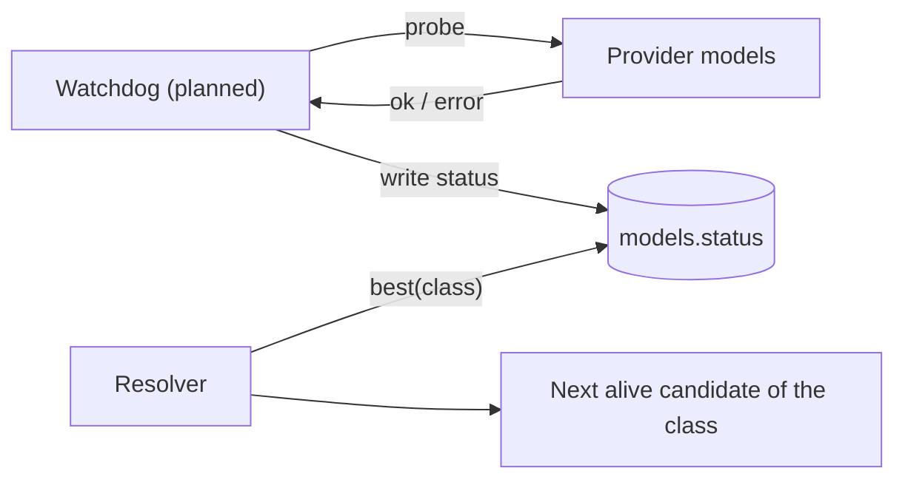
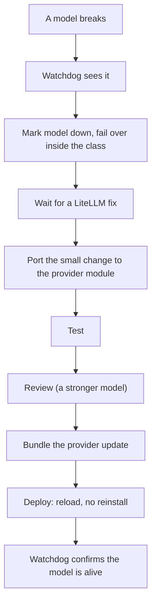

# Roadmap

Everything on this page is **planned** unless it says otherwise.

## Watchdog and failover inside a class (planned, task #90)

Today kiko-lite picks the best model of a class from the database (`Snapshot.best`) but does not check whether the
provider is alive, and it does not switch to the next model of the class when one breaks. The retry layer
(`kikolib/retry.py`) retries the same upstream on 429/5xx/connect errors only.

Honest history: the older LiteLLM-based kiko-full had a background health loop (`_health_loop`). kiko-lite does
not have one yet. The `models.status` and `last_check` columns exist (copied from kiko-full) but nothing in kiko-lite
writes them automatically.

Plan: a watchdog thread probes each enabled model, writes `status` (`ok` / `down`), and the resolver already prefers
`ok` over `unknown`. Failover then means: if the best model is `down`, the next candidate of the same class by
`priority` is used.

## Updatable providers (planned, task #91)

Providers should be updatable without reinstalling the program: one or 100 at once, reloaded without a reinstall.
Each provider module will record the LiteLLM commit it was ported from, so we know what upstream fixes we have and
what we do not. Today the provider table is a Python dict in `kiko_lite/providers/__init__.py` and the two
translators are normal modules; no reload mechanism exists.

## The event-driven fix procedure (planned)

LiteLLM is the world's collective experience with provider quirks. kiko-lite does not copy it; it ports small fixes
when a model breaks.

## Router target (planned)

A cheap home router can run kiko-lite as an always-on service.

| Item | Value |
|---|---|
| System | OpenWrt |
| Python | python3 3.11, 3.13 or 3.14 (kiko-lite needs 3.11+) |
| Space | 128 MB or more flash, 256 MB or more RAM, or a USB stick |
| Service | `procd` init script |
| Keys | env or `.env` next to the DB (no desktop key store on a router) |

Not verified: the exact OpenWrt package set, the memory of kiko-lite on the router architecture, and whether the
standard-library modules kiko-lite imports (`sqlite3`, `ssl`, `ctypes`) are all present in the OpenWrt python
packages. These need a test on a real device.

## Linux targets

Linux Mint 22.3 and Q4OS 6 (TDE). The Linux key stores (secret-tool, KWallet, dcop for TDE) are in
`kikolib/keystore.py`; `dcop` is marked unverified in `kikolib/README.md`, and `tools/linux_keystore_check.py` and
`docs/LINUX-KEYSTORE-TEST.md` exist for checking them on a real machine.
